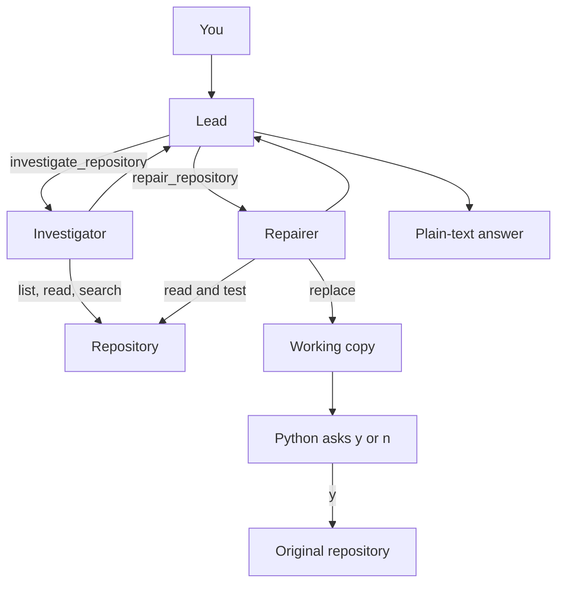

# AI Code Investigator

AI Code Investigator is a Python command-line tool, built on the [OpenAI Agents SDK](https://openai.github.io/openai-agents-python/), that uses agents to inspect a software repository, explain failing tests, and try a fix. Edits from the agent go to a temporary working copy and are copied onto the original files only after you approve the diff.

The current target is a small sample shop, `sample_repos/inventory-app/`. A user-chosen folder and GitHub repositories are planned.

## Key features

- Investigates a repository with agents and tools this application controls: list files, read files, and search code.
- Runs the project's pytest suite and uses that output in the investigation.
- Can modify files in a temporary working copy and rerun tests to validate changes. Each turn allows 8 `replace_in_file` calls, including calls that fail to match.
- Shows a diff and copies those files onto the original only if you type `y`.
- Runs as a lead agent with an investigator and a repairer, or as one agent with `--single`.
- Prints token use, tool calls, latency, and an estimated cost after every turn.

## Quick start

**Requirements:** Python 3.12, an OpenAI API key, and network access. Running the agent spends API credit. The test suite does not.

```bash
python3.12 -m venv .venv
source .venv/bin/activate
python -m pip install -r requirements.txt
cp .env.example .env
```

`.env` is git-ignored. Replace the placeholders:

```dotenv
OPENAI_API_KEY=your_api_key_here
OPENAI_MODEL=gpt-6-luna
```

If either name is missing, the process raises `RuntimeError` before any API call. The key stays in the environment. The model name is passed into the agent. Estimated cost is filled in only for `gpt-6-luna`, from the prices in `investigator/metrics.py`. Any other model still runs, and `estimated_cost_usd` is `null`.

```bash
python main.py
python main.py --single
```

The first message is fixed in `main.py`: what the repository implements, with a citation for each main type and function. The process then waits at `>`.

- Type a question to continue. Earlier turns from this process stay in an in-memory SQLite session.
- Press Enter on an empty line and the program asks you to type a question or `q`.
- Type `q` or `quit` to exit. The session is discarded.

## Example workflow

`sample_repos/inventory-app/` is a shop: products, stock, pricing, and orders. Bulk orders are meant to get 10% off from 20 units. The committed code uses `>`:

```python
if quantity > BULK_DISCOUNT_THRESHOLD:
```

An order of exactly 20 units is therefore full price. From that directory, `python -m pytest -q` reports:

```text
FAILED tests/test_pricing.py::test_bulk_discount_at_threshold - AssertionError: assert 100.0 == 90.0
FAILED tests/test_pricing.py::test_place_order_applies_bulk_discount_at_threshold - AssertionError: assert 100.0 == 90.0
2 failed, 2 passed
```

Quantity 5 and quantity 30 pass.

At `>`, a repair request you can type is:

```text
The shop tests are failing. Find the bug, fix it on the working copy, re-run until the tests pass or the replace limit is reached, and say what you changed.
```

The first `replace_in_file` in that turn copies the shop into `workspaces/<id>/`. Later tools in the turn see the copy. On a recorded repair of this bug, the copy changed the comparison from `>` to `>=`. The program then prints a diff and waits:

```diff
--- a/inventory/pricing.py
+++ b/inventory/pricing.py
@@ -6,6 +6,6 @@

 def calculate_total(product: Product, quantity: int) -> float:
     total = product.unit_price * quantity
-    if quantity > BULK_DISCOUNT_THRESHOLD:
+    if quantity >= BULK_DISCOUNT_THRESHOLD:
         total *= 1 - BULK_DISCOUNT_RATE
     return round(total, 2)
```

```text
Apply these changes to the original project? y/n
```

`y` copies the changed files onto the shop. `n` leaves the shop as it is. Either answer deletes that turn's copy. The two failing tests expect `90.0`, which is the total once 20 units qualify for the discount. Type `n` if you want the planted bug to remain for another run.

The model is not guaranteed to produce this diff on every run. A turn that never edits does not copy the shop and does not ask for approval.

## Architecture

By default you talk to a lead. It cannot read or edit the repository. It calls two specialist agents, exposed with `Agent.as_tool()`. Each specialist runs its own loop and returns a report. That report is handed back to the lead as JSON, and the lead writes the plain text you see. One message can call both specialists. The lead stays the speaker for the whole conversation.



| Agent | Tools | Result |
| --- | --- | --- |
| Investigator | `list_files`, `read_file`, `search_code` | `InvestigationReport`: a summary and citations (`path`, `start_line`, `end_line`) |
| Repairer | `read_file`, `run_tests`, `replace_in_file` | `RepairReport`: a summary, files it named, test counts, failed test names, and whether the last run passed |
| Lead | the two specialists only | Plain text. No required schema. |
| `--single` | all five repository tools | Plain text. One agent, no lead. |

`python main.py --single` is the same conversation with that one agent. Both modes exist to compare one agent that calls the repository tools directly with a lead that delegates to specialists. The printed metrics are what you compare.

| Tool | What it does |
| --- | --- |
| `list_files` | Relative paths. Skips `__pycache__`, `.git`, `.venv`, and `.pytest_cache`. |
| `read_file` | Numbered lines, optional 1-based range, at most 400 lines per call. |
| `search_code` | Literal, case-sensitive search. At most 5 matches per file and 50 total. |
| `run_tests` | `python -m pytest -q` in the current root. Timeout 30 seconds. A failing suite comes back as text. |
| `replace_in_file` | Replaces one exact snippet in an existing file on the working copy. Zero matches, or more than one, returns an error and does not write. |

A bad path is returned to the model as a string, and the turn continues. Python chooses the repository folder. The model does not receive it as an argument.

After each turn the program prints JSON metrics:

- `requests` — the number of model requests the SDK reports for that turn. One request can ask for several tools.
- `tool_calls` and `tool_calls_by_name` — Python functions the model asked to run. On the lead, those names are `investigate_repository` and `repair_repository`. The specialists' own calls appear in the [OpenAI trace](https://platform.openai.com/logs?api=traces).
- Token counts, `latency_seconds`, and `estimated_cost_usd`. The cost is an estimate from the token counts and the `gpt-6-luna` prices, not an invoice.

```text
main.py                         # conversation, metrics, approval
investigator/agent.py           # lead, investigator, repairer, single agent
investigator/tools.py           # tools and workspace state
investigator/repo.py            # disk and pytest
investigator/report.py          # InvestigationReport, RepairReport
investigator/metrics.py         # tokens, latency, estimated cost
tests/                          # tests for this project
sample_repos/inventory-app/     # repository under investigation
```

## Safety and limitations

The edit tool writes only to the working copy. Python copies files onto the original only after you type `y`, and only for paths that `replace_in_file` actually changed. It then deletes the working copy. The repairer's own list of files is not what gets copied. If every replacement fails, the copy is still created and then deleted, with no approval prompt.

`run_tests` still executes the project's pytest with your local permissions, so a test can have side effects that this approval step does not cover. Use it on a repository you trust. The working copy is not a sandbox.

Other limits of the current program:

- The repository path is hard-coded to the sample shop.
- The first message asks for an explanation. Only the investigator is unable to edit. The lead can still call the repairer, and `--single` has the edit tool.
- The printed answer is plain text. Citations are requested, not checked.
- The conversation ends when the process exits.
- `replace_in_file` cannot create a new file.
- Nothing stops the lead from calling the same specialist more than once in one turn.
- A folder left in `workspaces/` by an interrupted run stays until you remove it.

## Testing and CI

From the project root, with the virtual environment active:

```bash
pytest
```

`pytest.ini` collects `tests/` only, and these tests do not call the model. The shop's own tests run from `sample_repos/inventory-app/`, or when the agent calls `run_tests`.

[`.github/workflows/ci.yml`](.github/workflows/ci.yml) runs that same `pytest` on every push to `main` and every pull request into `main` (Python 3.12, no API key).

Pushing a tag such as `v0.1.0` runs [`.github/workflows/release.yaml`](.github/workflows/release.yaml). It runs `pytest` on that commit and, if the tests pass, creates a GitHub Release for the tag with generated notes. GitHub attaches the source archives. No API key.

## Roadmap

The tool can already inspect the sample shop, investigate its failing tests, propose a fix on a working copy, and apply that fix after approval, either with the lead or with `--single`.

Next: accept a repository you choose, and investigate a GitHub repository through the Model Context Protocol (MCP).
